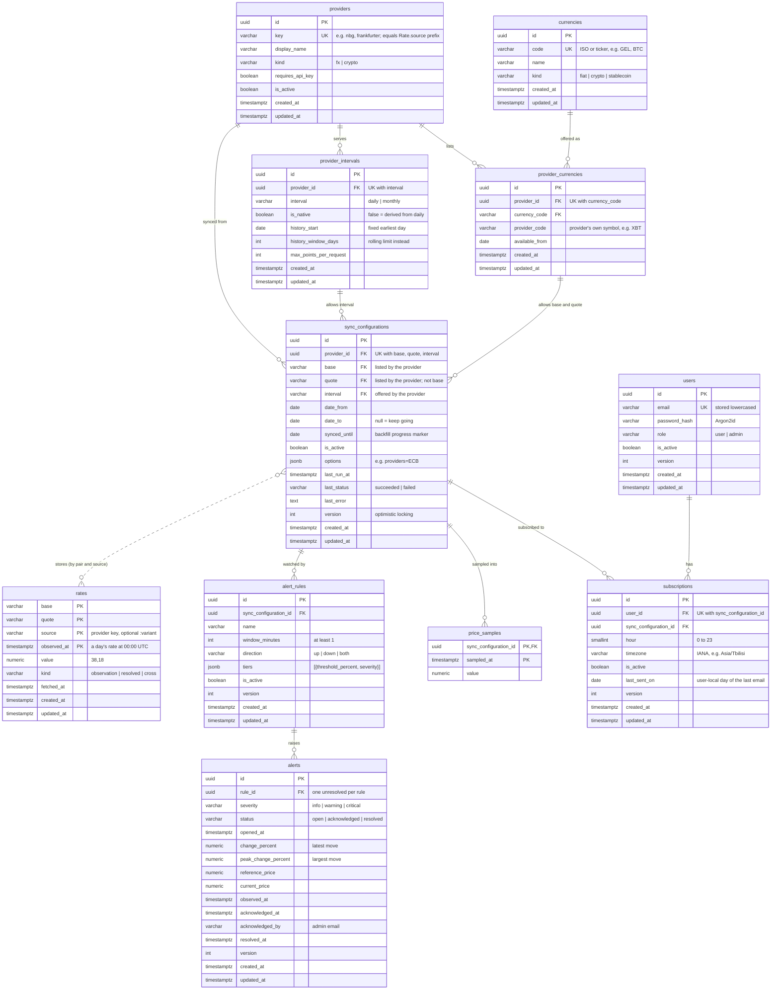

# Database schema

PostgreSQL 17 (with TimescaleDB installed), migration `0004`. Generated from the SQLAlchemy
models in `src/infrastructure/db/models` and checked against the live database.

Solid lines are foreign keys. The dotted line is a logical link only: `rates` has a natural
key and no foreign key, so a configuration's rates are found by pair and source.

## Tables

| Table | Area | Holds | Keys and constraints |
|---|---|---|---|
| `currencies` | catalog | Every currency the catalog knows | `code` unique |
| `providers` | catalog | Rate providers; `key` matches the integration | `key` unique |
| `provider_intervals` | catalog | Each provider's intervals and history limits | unique (`provider_id`, `interval`); cascade on provider delete |
| `provider_currencies` | catalog | Currencies each provider quotes | unique (`provider_id`, `currency_code`); cascade on provider or currency delete |
| `sync_configurations` | sync | What to collect: provider, pair, interval, date window, progress | unique (`provider_id`, `base`, `quote`, `interval`); composite FKs to `provider_intervals` and `provider_currencies` (twice) so the database rejects what the catalog doesn't allow; checks `base <> quote` and `date_to IS NULL OR date_from <= date_to`; partial index on `synced_until WHERE is_active` |
| `rates` | rates | Every stored rate; today's is overwritten until the day ends | primary key (`base`, `quote`, `source`, `observed_at`); indexes on (`base`, `quote`, `observed_at`) and (`base`, `quote`, `kind`, `observed_at`) |
| `alert_rules` | alerts | Price-move rules on one configuration | check `window_minutes >= 1`; cascade on configuration delete |
| `alerts` | alerts | One episode of a rule's price move | unique `rule_id WHERE status <> 'resolved'` (one open alert per rule); index on (`status`, `opened_at`); cascade on rule delete |
| `price_samples` | alerts | Live price per configuration per tick, pruned after 31 days | primary key (`sync_configuration_id`, `sampled_at`); index on `sampled_at`; cascade on configuration delete |
| `users` | accounts | Accounts and roles | `email` unique |
| `subscriptions` | accounts | A user's daily email about one configuration | unique (`user_id`, `sync_configuration_id`); check `hour BETWEEN 0 AND 23`; cascade on user or configuration delete |

All `id` columns are UUIDv7, so new rows sort by creation time. `created_at` and `updated_at`
are kept by the repository layer; `version` columns back optimistic locking.

## Allowed values

Stored as `varchar(16)`; the allowed values come from the domain enums in `src/domain/enums.py`.

| Column | Values |
|---|---|
| `currencies.kind` | `fiat`, `crypto`, `stablecoin` |
| `providers.kind` | `fx`, `crypto` |
| `provider_intervals.interval`, `sync_configurations.interval` | `daily`, `monthly` |
| `sync_configurations.last_status` | `succeeded`, `failed` |
| `rates.kind` | `observation`, `resolved`, `cross` |
| `alert_rules.direction` | `up`, `down`, `both` |
| `alerts.severity` | `info`, `warning`, `critical` |
| `alerts.status` | `open`, `acknowledged`, `resolved` |
| `users.role` | `user`, `admin` |

## Deleting

Deleting a sync configuration deletes its alert rules (and their alerts), its price samples
and its subscriptions. Deleting a user deletes their subscriptions. A provider can't be
deleted while sync configurations use it.
